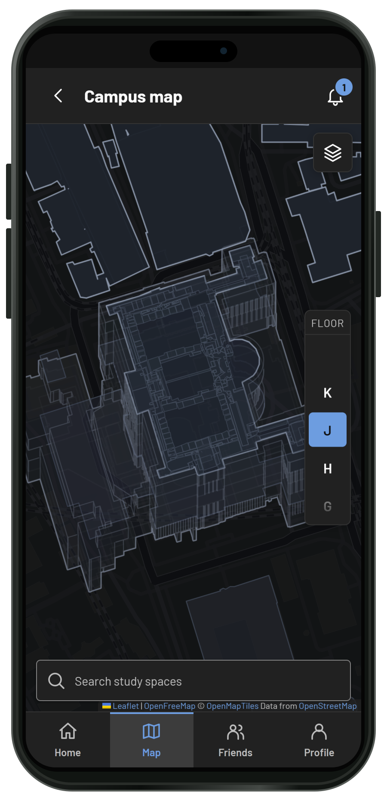

# Academic Study Spaces
**The Wurst Team**


Mobile first web app for seat reservation and study room finding. Fully implemented with map and features for ETH and expandable for any university. Complete with admin dashboard and everything needed to start operation. Served live for ETH students at https://02.hackathon.ethz.ch



## Features

- Reserve a study seat from anywhere: Reserve up to 15 min befor Check-in and keep it for two hours. Seat reservations can be extended starting from 20 mins before the end of the period. 10 mins before everyone will get a chance to reserve the seat. Reserve alone or in groups
- Find your study space from anywhere. We offer study room browsing and availability preview.You can find the right study space through browsing or using out interactive 3D-Map
- 3D-Map: Browse the campus and find resrevable seat spots or the next possible workspace. Three different information levels allow For use in different scenarios: Finding the right spot to reserve, Finding the next unoccupied room or study space and finding the right sports class or mensa after studying. The map works in the ETH centre and Hönggerberg and is fed real room layouts.
- Group system: Invite friends to join you while studying and book seats together. No racing to register at the same time: One person books for all

## Tech stack

| Layer | Technology |
| --- | --- |
| Frontend | React 19, TypeScript 6, Vite 8, React Router 8, TanStack Query 5, Mantine 9, Tailwind CSS 4 |
| Map | Leaflet + react-leaflet, MapLibre GL (via `@maplibre/maplibre-gl-leaflet`), polygon-clipping |
| API client | Hey API (`@hey-api/openapi-ts`), generated from the backend's OpenAPI schema |
| Backend | Python 3.12, FastAPI, Pydantic 2 / pydantic-settings, SQLAlchemy 2, Alembic, Pillow, uvicorn |
| Database | PostgreSQL 17 (psycopg 3) |
| Real-time | Server-sent events (`/api/v1/events`) |
| Tooling | uv (Python deps), npm (JS deps), Ruff, pytest, ESLint, Prettier, `node --test` |
| Runtime / deploy | Docker Compose, Caddy, GitHub Actions (SSH deploy, per-PR previews) |

## Quickstart

With make from repo root:

`make install`
`make backend`
`make frontend`

Without make from repo root:

```sh
uv sync --locked --project backend
npm ci --prefix frontend

docker compose up --build -d --wait

npm run dev --prefix frontend
```

For codebase orientation and an indepth guide on serving it locally, read ORIENTATION.md