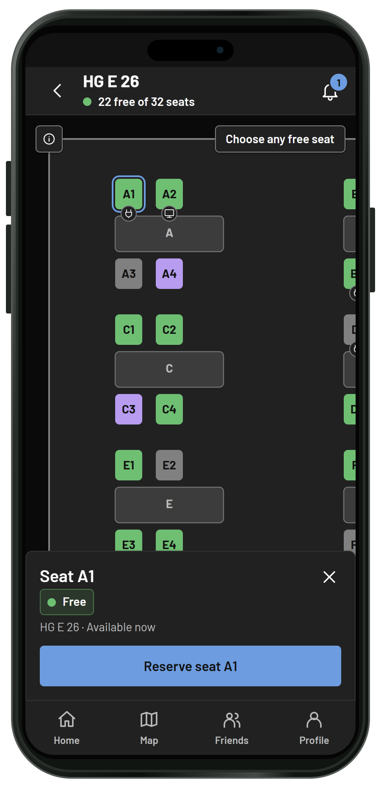
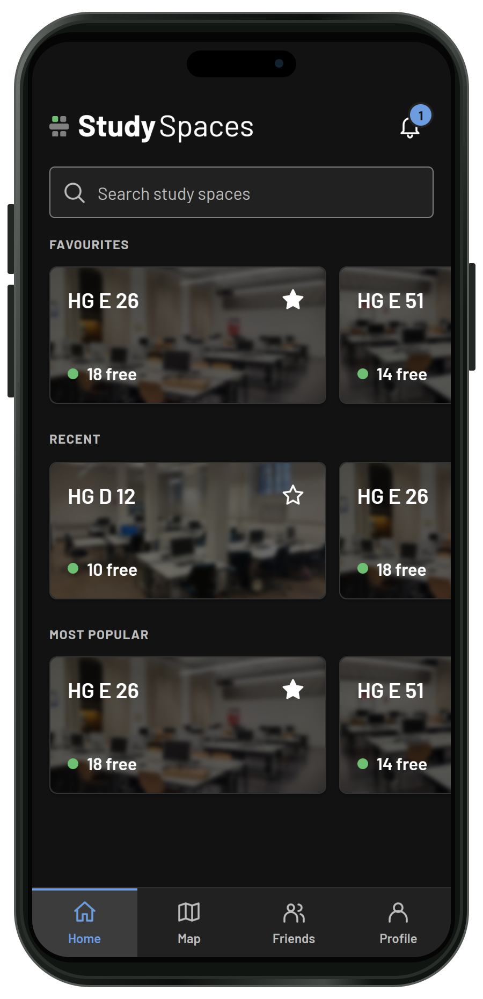
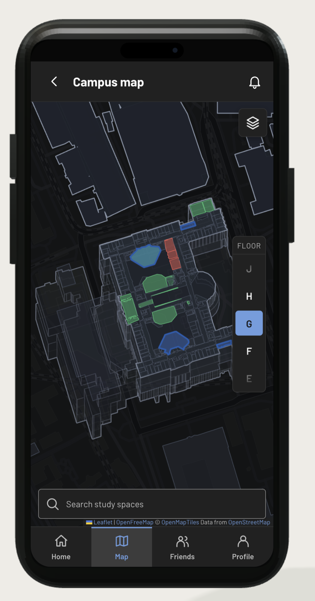
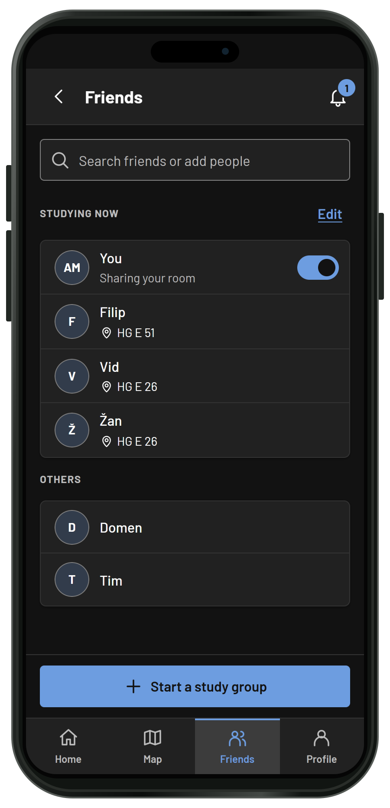

# Academic Study Spaces
**The Wurst Team**


<br>

Mobile first web app for seat reservation and study room finding. Fully implemented with map and features for ETH and expandable for any university. Complete with admin dashboard and everything needed to start operation. Served live for ETH students at https://02.hackathon.ethz.ch


## Features

<table>
  <tr>
    <td valign="top">
      <h3>Reserve a seat</h3>
      <p>Reserve up to 15 min before check-in and keep the seat for two hours. Extend your reservation starting 20 min before it ends; 10 min before the end, everyone gets a chance to reserve the seat. Reserve alone or in groups.</p>
    </td>
    <td width="300" align="center">
      
    </td>
  </tr>
  <tr>
    <td valign="top">
      <h3>Find your study space</h3>
      <p>Browse study rooms and preview their availability from anywhere. Find the right space by browsing or through the interactive 3D map.</p>
    </td>
    <td width="300" align="center">
      
    </td>
  </tr>
  <tr>
    <td valign="top">
      <h3>3D map</h3>
      <p>Browse the campus and find reservable seats or the next free workspace. Three information levels cover different needs: finding the right spot to reserve, finding the next unoccupied room, and finding a sports class or mensa after studying. The map covers ETH Zentrum and Hönggerberg and uses real room layouts.</p>
    </td>
    <td width="300" align="center">
      
    </td>
  </tr>
  <tr>
    <td valign="top">
      <h3>Groups</h3>
      <p>Invite friends to join you while studying and book seats together. No racing to register at the same time: one person books for all.</p>
    </td>
    <td width="300" align="center">
      
    </td>
  </tr>
</table>


## Tech stack

| Layer | Technology |
| --- | --- |
| Frontend | React 19, TypeScript 6, Vite 8, React Router 8, TanStack Query 5, Mantine 9, Tailwind CSS 4 |
| Map | Leaflet + react-leaflet, MapLibre GL (via `@maplibre/maplibre-gl-leaflet`), polygon-clipping |
| API client | Hey API (`@hey-api/openapi-ts`), generated from the backend's OpenAPI schema |
| Backend | Python 3.12, FastAPI, Pydantic 2 / pydantic-settings, SQLAlchemy 2, Alembic, Pillow, uvicorn |
| Database | PostgreSQL 17 (psycopg 3) |
| Real-time | Server-sent events (`/api/v1/events`) |
| Tooling | uv (Python deps), npm (JS deps), Ruff, pytest, ESLint, Prettier, `node --test` |
| Runtime / deploy | Docker Compose, Caddy, GitHub Actions (SSH deploy, per-PR previews) |

## Quickstart

With make from repo root:

`make install`
`make backend`
`make frontend`

Without make from repo root:

```sh
uv sync --locked --project backend
npm ci --prefix frontend

docker compose up --build -d --wait

npm run dev --prefix frontend
```

For codebase orientation and an indepth guide on serving it locally, read ORIENTATION.md