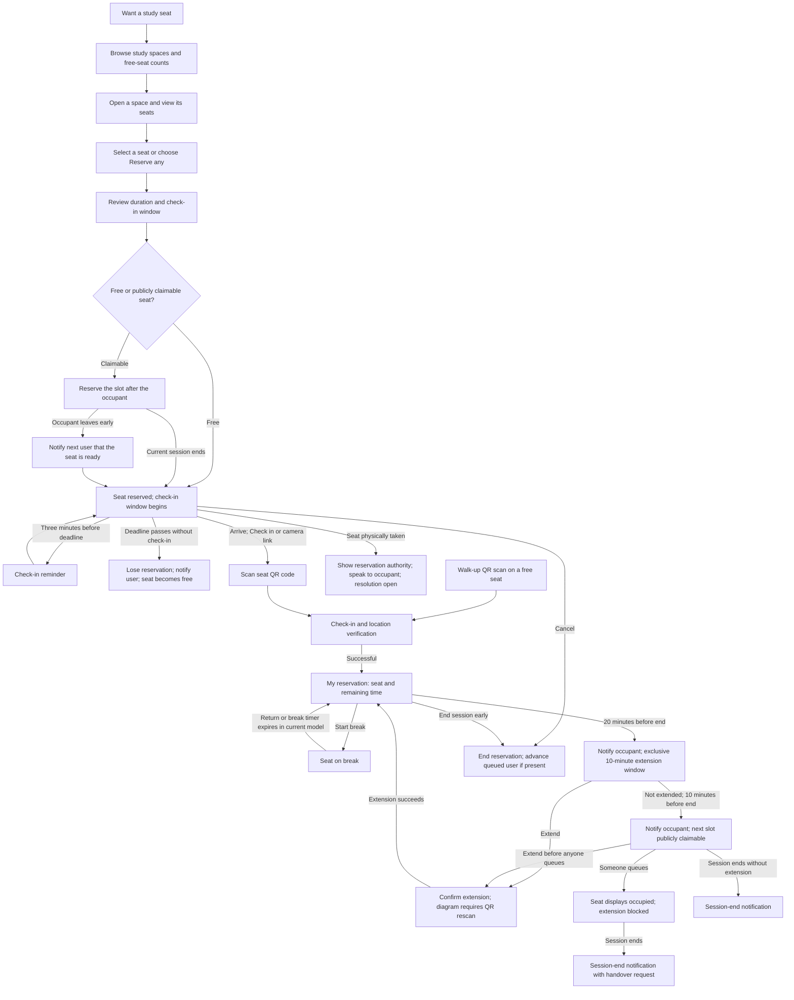

# User Flow: ETH Study Space App

This document combines the [user-flow diagram](user-flwo.drawio.svg) with the [data-model proposal](Data%20Model%20ETH%20Study%20Space%20App.md). It describes the proposed experience, not verified application behavior. Details added by the data model are identified below; conflicts and unresolved rules remain explicit.

## Flow overview

The flowchart shows successful check-in and extension paths. Verification failures and dispute resolution are not specified by the sources. The extension path is summarized as returning to the active session; the diagram routes it through the reservation popup, whereas the data model extends the existing reservation.

## Authentication

The implemented backend trusts the managed hackathon proxy, which handles Switch edu-ID login and supplies `X-User-Id`. That email maps to a stable UUID for reservation ownership; the app has no separate login page. The frontend profile and home avatar fetch the current identity from `/api/v1/me`; local demo mode starts with a demo account. Users can edit their display name and upload or remove a photo, then save both to `user_profiles`; email and booking identity remain unchanged. Logout is not implemented. Frontend reservation/QR flows remain mocked; real check-in routing and resuming the intended check-in after login still need implementation and verification.

## 1. Find and reserve a seat

1. A user at home or in class opens the map to find a study space.
2. Each study space shows how many seats are free. Opening a space reveals its seat arrangement and current seat states.
3. The user selects a seat, or chooses **Reserve any** to let the app choose. The seat-selection strategy for Reserve any is unspecified.
4. A popup explains the fixed session duration, **T**, and the check-in window, **X**. The user reserves the seat.
5. A free seat becomes **reserved** while the user travels to it. Selecting a publicly claimable occupied seat instead reserves the next slot; the current occupant keeps the seat until their session ends or they leave early.

The data model adds two reservation rules: an immediate reservation starts now, and a queued reservation starts at the current occupant's scheduled end. Reserving an arbitrary future time remains an open question.

## 2. Arrive and check in

- From the reservation, the user selects **Check in** and scans the seat's QR code. Alternatively, scanning the QR code with the phone camera opens the relevant screen if the user is authorized.
- The diagram includes backend location verification. Whether it is required for every QR scan or only button check-in is unresolved in the data model.
- After successful check-in, the seat becomes **occupied**, and the app shows the seat and remaining time.
- If the user has not checked in three minutes before the deadline, they receive a reminder. If the deadline passes without check-in, they lose the reservation, receive a notification, and the seat becomes free.
- If the seat is physically occupied by someone else, the app's reservation is intended to establish authority under university rules. The user is expected to speak to the occupant. This is a trust-based approach with no defined dispute-resolution process.

**Data-model addition:** scanning a free seat's QR code as a walk-up user creates a reservation and checks the user in together.

## 3. Manage an active reservation

The **My reservation** screen shows the seat location, a countdown, and **Extend**, **Break**, and **End** controls. It also shows **Check in** until check-in succeeds. The sources do not fully define when each control is enabled.

**Data-model additions:** starting a break records a break deadline; returning ends the break early. The seat appears **on break** while the break is active. In the proposed state calculation, an expired break stops marking the seat as on break, and the reservation becomes active again if the session has not ended. The sources do not define a penalty, notification, or seat release for overstaying a break. Break limits and whether breaks pause the session remain open.

Ending the session checks the user out early. The data model also allows cancellation before check-in. Both release the reservation and make the seat available to the next queued user, if there is one.

## 4. Extend or hand over

1. **20 minutes before the session ends:** the occupant receives a notification that they have a 10-minute priority window to extend. The seat is claimable only to that occupant; other users still see it as occupied.
2. **Extend during priority:** the occupant confirms the extension. The diagram explicitly requires scanning the QR code again. The data model adds **T** to the existing session end; it does not describe this rescan.
3. **10 minutes before the session ends, if not extended:** the occupant receives a notification that anyone can now reserve the next slot. The seat becomes publicly claimable, shown in orange.
4. **During public availability:** another user can reserve the slot starting at the occupant's session end. The occupant may still extend if nobody else has reserved it. Once someone queues, the seat displays occupied again, and the occupant cannot extend into that booking.
5. **At session end:** the occupant receives an end notification. If someone has reserved the next slot, the notification asks them to hand over the seat. The next user's reservation becomes pending, with its own check-in window.

If the occupant checks out early after someone has queued, the diagram calls for a notification to the next user that the seat is ready. The seat becomes **reserved**, and that user can check in immediately. The revised deadline and session-end rules for this early handover need clarification below.

## Seat states

These are seat states shown on the map or room layout, rather than every internal reservation status.

| Seat state | Meaning and visibility |
| --- | --- |
| Free | No current reservation, or the current reservation missed its check-in deadline. Available for an immediate reservation. |
| Reserved | A reservation has started, but its owner has not yet checked in and is still within the check-in window. |
| Occupied | The user has checked in. Other users see this outside the public window, or once the next slot has been reserved. |
| On break | The current user has an active break. The proposed model gives this display state precedence over claimable. |
| Claimable, private | During the priority window, only the occupant sees the extension opportunity; others still see occupied. |
| Claimable, public (orange) | During the public window, an active seat with no queued reservation can be reserved for the next slot. It is not immediately free. |

The main map's free-seat count counts **free** seats, rather than treating future claimable slots as free now.

## Timing and notifications

The diagram uses **T** and **X** without assigning values. Concrete values below come from the data-model proposal. Placeholder values are not final requirements.

| Rule | Proposed timing | User-visible effect |
| --- | --- | --- |
| Session duration, T | 120 minutes | Fixed session length; each extension adds another T. The start of this clock conflicts between sources. |
| Check-in window, X | 15 minutes — placeholder | Deadline to check in after the reservation starts. For a queued slot, this starts when that slot begins. |
| Check-in reminder | X minus 3 minutes after reservation start | Reminder to check in; at the placeholder X, this is 12 minutes after start. |
| Missed check-in | At the check-in deadline | Reservation lost, seat freed, and user notified. |
| Private priority | From 20 to 10 minutes before session end | Occupant notified; exclusive opportunity to extend. |
| Public availability | Final 10 minutes, if not extended | Occupant notified; anyone can reserve the next slot if it is unclaimed. |
| Session end | At the current session end | End notification, including a handover request if someone has queued. |
| Early handover | When the current occupant checks out early | Queued user notified that the seat is ready for check-in. |
| Maximum break | 30 minutes — placeholder | Proposed break deadline; consequences of an overrun remain unspecified. |
| Location radius | Unspecified placeholder | Used to verify proximity to the study space if location checking is required. |

## Backend behavior supporting the flow

The data model proposes computing reservation and seat states from recorded timestamps and the current time. Expiry changes availability without waiting for a notification job. The next reservation attempt closes out an expired no-show record before booking the seat.

Database constraints are intended to prevent overlapping reservations for the same seat and overlapping seat bookings for the same user. They also reject an extension that overlaps a queued reservation. These are proposed guarantees, not confirmation that the current application implements them.

The proposed notification job runs every minute and records sent notifications to avoid duplicates. Delivery therefore follows threshold detection rather than promising exact-second delivery. The diagram also requires an early-handover notification; its delivery mechanism is not specified in the data-model notification list.

## Conflicts and open decisions

| Topic | What still needs a decision |
| --- | --- |
| Session clock | The diagram says the priority notification follows T minus 20 minutes from check-in. The data model sets session end to reservation start plus T, so arriving later reduces seated time. Choose one clock before implementation. |
| Extension flow | The diagram requires confirmation and an intentional QR rescan, then returns to the reservation popup. The data model only extends the existing end time by T. Clarify the rescan requirement and whether the popup is reused without creating a new pending reservation. |
| Early handover timing | The diagram makes the queued seat immediately available. The data-model text moves both start and check-in deadline to now, which would leave no check-in window under its own state rules. Specify the new deadline and whether the original session end stays fixed or moves with the start. |
| Break policy | Decide how many breaks are allowed, whether a break pauses the session, and what happens when the user does not return by the break deadline. |
| Breaks near session end | The state calculation shows on break before considering claimability. Clarify how priority, public queueing, and extension interact with an active break. |
| Check-in verification | Decide whether location is required for QR check-in, button check-in, or both; set the radius and define behavior when verification fails or permission is unavailable. |
| Future reservations | Decide whether users may choose arbitrary future times or only reserve immediately and queue behind an occupant. |
| QR links after login | Managed-proxy authentication is implemented. Define and verify frontend routing back to the intended seat/check-in after proxy login. |
| Occupied-seat disputes | The app shows reservation authority, but escalation and enforcement remain undefined. A reports table is outside the current MVP proposal. |
| Seat layout | The data model leaves the room-layout JSON shape undecided. This does not change the documented browsing flow. |

The data-model proposal also leaves per-room rules, opening hours, seat features, stored check-in method, end reasons, extension counts, an explicit link between successive reservations, and a full notification queue outside the MVP. This document adds no product behavior for those items.
